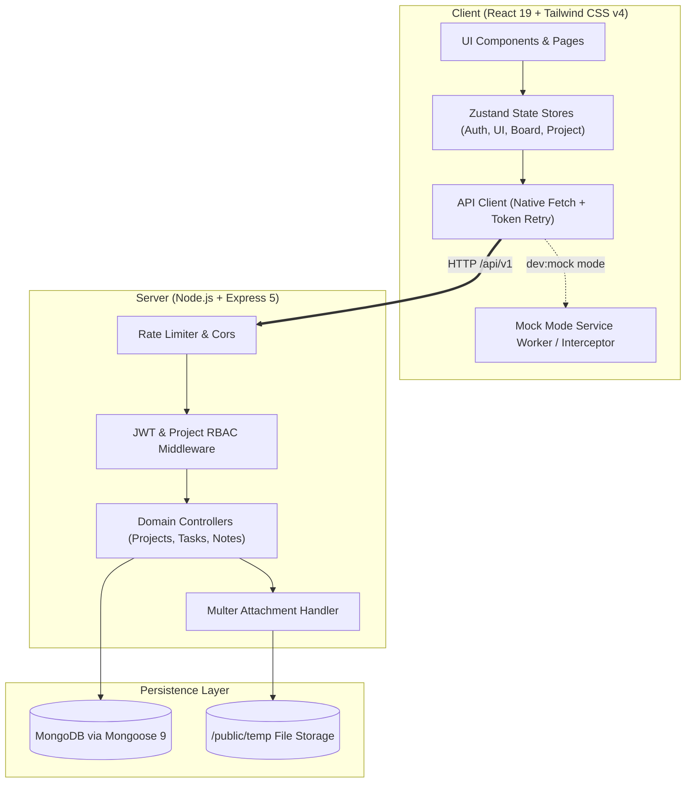

# ⚡ WorkPulse — Modern Full-Stack Task & Project Management Platform

[](https://nodejs.org/)
[](https://react.dev/)
[](https://expressjs.com/)
[](https://mongoosejs.com/)
[](https://tailwindcss.com/)
[](https://vitejs.dev/)
[](TESTCASES.md)
[](LICENSE)

> A modern, high-performance collaborative project management platform engineered with **React 19**, **Express 5**, and **MongoDB**. Designed with an obsession for speed: optimistic UI updates, drag-and-drop Kanban pipelines, keyboard-first navigation via a custom **⌘K Command Palette**, 3-tier role-based access control, and complete mobile-first responsiveness.

---

## 📌 Table of Contents

- [Overview](#-overview)
- [Key Engineering Highlights](#-key-engineering-highlights)
- [Feature Showcase](#-feature-showcase)
- [Architecture & Data Flow](#-architecture--data-flow)
- [Tech Stack](#-tech-stack)
- [Quick Start Guide](#-quick-start-guide)
  - [Prerequisites](#prerequisites)
  - [Instant Mock Mode (Zero-Config Review)](#instant-mock-mode-zero-config-review)
  - [Full-Stack Setup (Backend + Frontend)](#full-stack-setup-backend--frontend)
- [API Documentation & Architecture](#-api-documentation--architecture)
- [Security & Performance](#-security--performance)
- [Testing & Quality Assurance](#-testing--quality-assurance)
- [Author & Connect](#-author--connect)

---

## 🚀 Overview

**WorkPulse** was developed to bridge the gap between heavy enterprise project tracking software and fluid, developer-friendly productivity apps like Linear and Notion. It delivers instant, zero-latency interactions using optimistic client state, robust server-side RBAC authorization, and automated background syncing.

Whether viewed on a desktop multi-monitor workstation or a mobile device, WorkPulse delivers a cohesive, responsive experience.

---

## 💡 Key Engineering Highlights

### 1. Optimistic UI & Fluid Kanban Pipelines
- Built with `@dnd-kit` for accessible, touch-friendly, fluid drag-and-drop transitions across **To Do**, **In Progress**, and **Done** columns.
- State is updated optimistically in the client store; network requests resolve in the background with automated rollbacks on failure.

### 2. Dual-Mode Architecture (Production & Zero-Config Mock API)
- Includes an integrated **Mock Server Mode** (`npm run dev:mock`) simulating latency, error handling, session cookies, and CRUD operations.
- Enables recruiters, collaborators, and CI pipelines to explore the full client application immediately without configuring a local MongoDB instance.

### 3. Handcrafted Accessible ⌘K Command Palette
- Zero third-party dependency command palette featuring fuzzy navigation, quick actions (Create Task, Create Project, Toggle Theme), role-gated triggers, and keyboard shortcuts (`Ctrl+K` / `⌘K`).

### 4. Hardened Security & Frictionless Auth
- **Dual-Token Flow**: JWT access tokens (15m) paired with refresh-token rotation (7d) transmitted securely via `httpOnly` `SameSite=Lax` cookies with Bearer header fallback.
- **Brute-Force Protection**: Rate limiting on sensitive endpoints via `express-rate-limit` with exponential retry headers (`429 Too Many Requests`).
- **Streamlined Onboarding**: Instant registration that signs users directly into their workspace without verification barriers.

### 5. 3-Tier Granular Role-Based Access Control (RBAC)
- Project-scoped authorization distinguishing between **Admin** (project settings, member access, project deletion), **Project Admin** (task & note management, adding members), and **Team Member** (viewing tasks, updating assigned subtasks).

### 6. Production Build Optimization
- Intelligent manual chunking separating heavy vendor libraries (`recharts`, `framer-motion`, `@dnd-kit`, `react-router`), resulting in initial page loads under **95 kB gzipped**.

---

## ✨ Feature Showcase

| Feature | Description |
|---|---|
| **Kanban Board** | Visual 3-column workflow with drag-and-drop sorting, priority badges (`low`, `medium`, `high`, `urgent`), due-date alerts, and subtask progress rings. |
| **Task Detail Lightbox** | Multi-image attachments (up to 5 × 1MB images via Multer), interactive subtask checklists, Markdown task descriptions, and member assignment. |
| **Project Dashboard** | Real-time SVG status donut chart (handcrafted without bulky libraries), member distribution counters, and live activity streams. |
| **Project Notes & Docs** | Markdown-supported note repository with optimistic note pinning, search, and paginated views. |
| **Team Member Management** | Searchable member directory, role assignment dropdowns, member workload distribution pipelines, and safe removal flows. |
| **Data Export Engine** | One-click client-side export to both **CSV** and structured **JSON** for tasks, project metadata, and activity audits. |
| **Theme System** | Seamless Dark / Light mode switching with zero dark-mode flash using pre-paint inline script execution. |

---

## 🏗 Architecture & Data Flow



---

## 🛠 Tech Stack

### Frontend
- **Framework**: [React 19](https://react.dev/) + [Vite 6](https://vitejs.dev/)
- **Routing**: [React Router v7](https://reactrouter.com/) (Route code-splitting & lazy evaluation)
- **State Management**: [Zustand v5](https://github.com/pmndrs/zustand)
- **Styling**: [Tailwind CSS v4](https://tailwindcss.com/) + OKLCH dynamic color palettes
- **Drag & Drop**: [@dnd-kit/core](https://dndkit.com/)
- **Animations**: [Framer Motion](https://www.framer.com/motion/)
- **Icons**: [Lucide React](https://lucide.dev/)

### Backend
- **Runtime**: [Node.js v20+](https://nodejs.org/) (ESM)
- **Framework**: [Express 5](https://expressjs.com/)
- **Database**: [MongoDB](https://www.mongodb.com/) with [Mongoose 9](https://mongoosejs.com/)
- **Authentication**: JWT (`jsonwebtoken`) with `bcryptjs` password hashing & cookie parser
- **File Uploads**: [Multer](https://github.com/expressjs/multer) with MIME type and size validation
- **Documentation**: Swagger UI + OpenAPI 3.0 specification builder

### Testing & Quality Tools
- **Unit / Integration**: [Jest](https://jestjs.io/) + [Supertest](https://github.com/ladjs/supertest)
- **E2E Browser Automation**: [Puppeteer](https://pptr.dev/)
- **Linting & Code Style**: ESLint 9 + Prettier

---

## ⚡ Quick Start Guide

### Prerequisites
- **Node.js**: `v20.0.0` or higher
- **npm**: `v10.0.0` or higher
- **MongoDB** *(optional if running in Mock Mode)*: Local MongoDB instance or MongoDB Atlas URI

---

### Option A: Instant Mock Mode (Zero-Config Review)
Want to evaluate the frontend immediately without setting up databases? Run the full app with mock data:

```bash
# 1. Clone repository
git clone https://github.com/Mangeshlawande/Task-Management-Platform.git
cd Task-Management-Platform

# 2. Navigate to client and install dependencies
cd projectmanagementbackend/client
npm install

# 3. Launch in mock mode
npm run dev:mock
```
🌐 Open **`http://localhost:5173`** in your browser to test all boards, modals, search, notes, and dashboards with demo user accounts.

---

### Option B: Full-Stack Setup (Backend + Frontend)

#### 1. Backend Setup
```bash
cd projectmanagementbackend

# Install dependencies
npm install

# Configure environment variables
cp .ENV.SAMPLE .env

# Start backend server with file watch
npm run dev
```
> The API will be available at **`http://localhost:8000`** and Swagger docs at **`http://localhost:8000/api-docs`**.

#### 2. Seed Database (Optional)
Populate your database with demo projects, members, tasks, and notes:
```bash
npm run seed
```

#### 3. Frontend Setup
In a new terminal window:
```bash
cd projectmanagementbackend/client

# Install dependencies
npm install

# Start Vite dev server
npm run dev
```
🌐 Access the live application at **`http://localhost:5173`**.

---

## 📖 API Documentation & Endpoints

Interactive Swagger UI documentation is available at **`/api-docs`** on the backend server.

All responses follow a predictable JSON envelope:
```json
{
  "statusCode": 200,
  "data": { ... },
  "message": "Resource fetched successfully",
  "success": true
}
```

### Core API Summary
| Group | Method | Endpoint | Description |
|---|---|---|---|
| **Auth** | `POST` | `/api/v1/auth/register` | Register new account & start session |
| **Auth** | `POST` | `/api/v1/auth/login` | Login with username or email |
| **Auth** | `POST` | `/api/v1/auth/refresh-token` | Rotate refresh token & get new access token |
| **Auth** | `GET` | `/api/v1/auth/me` | Fetch active authenticated profile |
| **Projects** | `GET, POST` | `/api/v1/projects` | List or create projects |
| **Projects** | `GET, PUT, DEL` | `/api/v1/projects/:projectId` | Project detail, update, or delete |
| **Members** | `GET, POST` | `/api/v1/projects/:projectId/members` | List or invite team members |
| **Tasks** | `GET, POST` | `/api/v1/projects/:projectId/tasks` | List or create tasks (with attachments) |
| **Tasks** | `PUT, DELETE`| `/api/v1/projects/:projectId/tasks/:taskId` | Update status, assignees, or remove |
| **Subtasks** | `POST, PUT` | `/api/v1/projects/:projectId/tasks/:taskId/subtasks` | Subtask checklist CRUD & toggle |
| **Notes** | `GET, POST` | `/api/v1/projects/:projectId/notes` | Paginated project discussions & pinned notes |
| **Dashboard** | `GET` | `/api/v1/projects/:projectId/dashboard` | Aggregated metrics and status distribution |

---

## 🔒 Security & Performance

- **Sanitization & Validation**: All request payloads are strictly validated using `express-validator` with centralized schema definitions.
- **CSRF & Cookie Protection**: Session tokens are isolated inside `httpOnly`, `Secure` (production), and `SameSite=Lax` cookies, protecting against XSS token harvesting.
- **Cascading Deletion**: Account or project deletion triggers clean cascading cleanup across memberships, tasks, subtasks, and notes preventing orphaned database records.
- **Bundle Optimization**: Lazy-loaded route boundaries combined with manual chunking yield minimal initial bundle sizes and sub-second page transitions.

---

## 🧪 Testing & Quality Assurance

```bash
# Run backend Supertest & Jest test suite
cd projectmanagementbackend
npm test

# Run client mock smoke tests
cd projectmanagementbackend/client
npm test

# Run ESLint validation
npm run lint
```

Refer to [`TESTCASES.md`](TESTCASES.md) for the complete end-to-end test verification matrix covering Authentication, Kanban Boards, Member Access, and Command Palette workflows.

---

## 👤 Author & Connect

**Mangesh Lawande**  
- **GitHub**: [@Mangeshlawande](https://github.com/Mangeshlawande)
- **Repository**: [Task-Management-Platform](https://github.com/Mangeshlawande/Task-Management-Platform)
- **Role**: Full-Stack Engineer

---

## 📄 License

This project is licensed under the [MIT License](LICENSE) — feel free to use it for portfolio showcases, learning, or enterprise extension.
