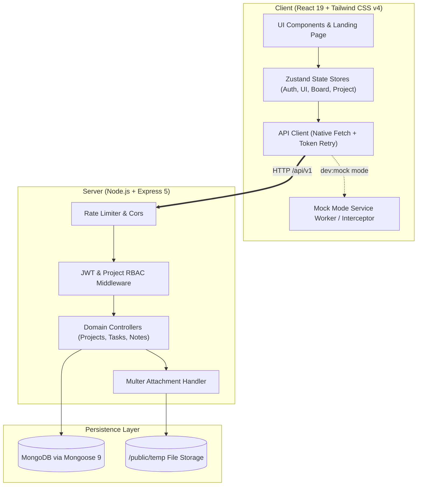

# ⚡ WorkPulse — Modern Full-Stack Task & Project Management Platform

[](https://nodejs.org/)
[](https://react.dev/)
[](https://expressjs.com/)
[](https://mongoosejs.com/)
[](https://tailwindcss.com/)
[](https://vitejs.dev/)
[](TESTCASES.md)
[](LICENSE)

> A modern, high-performance collaborative project management platform engineered with **React 19**, **Express 5**, and **MongoDB**. Designed with an obsession for speed: optimistic UI updates, drag-and-drop Kanban pipelines, keyboard-first navigation via a custom **⌘K Command Palette**, 3-tier role-based access control, and complete mobile-first responsiveness.

---

## 📌 Table of Contents

- [Overview](#-overview)
- [Key Engineering Highlights](#-key-engineering-highlights)
- [Solutions by Team & Use Cases](#-solutions-by-team--use-cases)
- [System Overview & Workflow Guide](#-system-overview--workflow-guide-help-center)
- [Feature Showcase](#-feature-showcase)
- [Architecture & Data Flow](#-architecture--data-flow)
- [Tech Stack](#-tech-stack)
- [Quick Start Guide](#-quick-start-guide)
  - [Prerequisites](#prerequisites)
  - [Instant Mock Mode (Zero-Config Review)](#instant-mock-mode-zero-config-review)
  - [Full-Stack Setup (Backend + Frontend)](#full-stack-setup-backend--frontend)
- [API Documentation & Architecture](#-api-documentation--architecture)
- [Security & Performance](#-security--performance)
- [Testing & Quality Assurance](#-testing--quality-assurance)
- [Contact & Collaboration](#-contact--collaboration)

---

## 🚀 Overview

**WorkPulse** was developed to bridge the gap between heavy enterprise project tracking software and fluid, developer-friendly productivity apps like Linear and Notion. It delivers instant, zero-latency interactions using optimistic client state, robust server-side RBAC authorization, and automated background syncing.

Whether viewed on a desktop multi-monitor workstation or a mobile device, WorkPulse delivers a cohesive, responsive experience.

---

## 💡 Key Engineering Highlights

### 1. Optimistic UI & Fluid Kanban Pipelines
- Built with `@dnd-kit` for accessible, touch-friendly, fluid drag-and-drop transitions across **To Do**, **In Progress**, and **Done** columns.
- State is updated optimistically in the client store; network requests resolve in the background with automated rollbacks on failure.

### 2. Dual-Mode Architecture (Production & Zero-Config Mock API)
- Includes an integrated **Mock Server Mode** (`npm run dev:mock`) simulating latency, error handling, session cookies, and CRUD operations.
- Enables recruiters, collaborators, and CI pipelines to explore the full client application immediately without configuring a local MongoDB instance.

### 3. Handcrafted Accessible ⌘K Command Palette
- Zero third-party dependency command palette featuring fuzzy navigation, quick actions (Create Task, Create Project, Toggle Theme), role-gated triggers, and keyboard shortcuts (`Ctrl+K` / `⌘K`).

### 4. Hardened Security & Frictionless Auth
- **Dual-Token Flow**: JWT access tokens (15m) paired with refresh-token rotation (7d) transmitted securely via `httpOnly` `SameSite=Lax` cookies with Bearer header fallback.
- **Brute-Force Protection**: Rate limiting on sensitive endpoints via `express-rate-limit` with exponential retry headers (`429 Too Many Requests`).
- **Streamlined Onboarding**: Instant registration that signs users directly into their workspace without verification barriers.

### 5. 3-Tier Granular Role-Based Access Control (RBAC)
- Project-scoped authorization distinguishing between **Admin** (project settings, member access, project deletion), **Project Admin** (task & note management, adding members), and **Team Member** (viewing tasks, updating assigned subtasks).

### 6. Production Build Optimization
- Intelligent manual chunking separating heavy vendor libraries (`recharts`, `framer-motion`, `@dnd-kit`, `react-router`), resulting in initial page loads under **95 kB gzipped**.

---

## 🎯 Solutions by Team & Use Cases

WorkPulse provides tailored solutions for modern cross-functional teams, eliminating the clutter and administrative friction common in traditional enterprise tools:

### 1. 🚀 Product Management Teams
- **Pain Point**: Product managers get bogged down maintaining complex Jira boards, updating disconnected sprint spreadsheets, and tracking fragmented subtask progress.
- **WorkPulse Solution**:
  - **Sprint Backlog Grooming**: Organize initiatives with priority tags (`urgent`, `high`, `medium`, `low`) and due-date alerts.
  - **Progress Rollups**: Subtasks automatically roll up into real-time visual completion percentages on Kanban cards.
  - **Roadmap Discussions**: Maintain living product requirements and sprint retrospective documentation inside project-scoped Markdown notes.
  - **Stakeholder Exports**: Export task inventories, assignees, and completion milestones to CSV or JSON with one click.

### 2. 🎨 Design Teams
- **Pain Point**: Designers struggle with visual review feedback scattered across Slack messages, lost attachment uploads, and disconnected Figma link threads.
- **WorkPulse Solution**:
  - **Multi-Image Attachment Lightbox**: Upload up to 5 image assets (1MB each) per task card with high-resolution lightbox previews.
  - **Design Specs in Markdown**: Document typography, spacing tokens, and component guidelines directly alongside task tickets.
  - **Iterative Checklists**: Create subtask checklists for wireframes, component design, prototype review, and design handoff.

### 3. 📢 Marketing Teams
- **Pain Point**: Marketing campaigns involve dozens of parallel dependencies (content, social, ads, email, PR) that slip without clear delivery pipelines.
- **WorkPulse Solution**:
  - **Multi-Channel Launch Boards**: Dedicated boards mapping marketing phases from idea generation to launch day distribution.
  - **Editorial Calendars**: Track blog posts, newsletter schedules, and campaign deadlines with due-date tracking.
  - **Asset Approval Workflows**: Centralize copy, banners, and collateral inside task discussions with full version history.

### 4. 🏢 Management & Leadership Teams
- **Pain Point**: Engineering leaders and executives lack an instant high-level snapshot of project health, member capacity, and delivery bottlenecks.
- **WorkPulse Solution**:
  - **Executive Dashboard Donut**: Hand-rolled SVG status breakdown donut displaying real-time task distribution (`todo`, `in_progress`, `done`).
  - **Workload Capacity Monitoring**: Visual member pipeline modal displaying active assignments per team member to prevent burnout.
  - **Role-Based Governance**: Restrict administrative actions (project deletion, member role upgrades) while empowering team autonomy.

### 5. ⚡ Startups & Scale-ups
- **Pain Point**: Early-stage startups need to move fast without spending hours configuring permissions, setting up email verification servers, or paying $15–$25/user/month.
- **WorkPulse Solution**:
  - **Instant Sign-up & Onboarding**: Zero verification gate — users sign up and land directly in their workspace in under 5 seconds.
  - **⌘K Keyboard Speed**: Add tasks and switch contexts instantly without touching the mouse.
  - **Zero-Tool Sprawl**: Replaces separate note apps, to-do lists, and status trackers with a single lightweight hub.

### 6. 🌍 Remote & Distributed Teams
- **Pain Point**: Distributed teams face time-zone lag, status-update fatigue, and dropped connections when traveling or working remotely.
- **WorkPulse Solution**:
  - **Asynchronous Standups**: Project-level Markdown notes replace scheduled status meetings with self-documenting updates.
  - **Connection Resilience Banner**: Detects offline state (`navigator.onLine` / API healthcheck probes) and seamlessly reconnects with automated background sync.
  - **Transparent Accountability**: Assignee avatars and status chips make task ownership obvious across global time zones.

### 7. ⚙️ DevOps & Engineering Teams
- **Pain Point**: Developers hate leaving their IDEs to wrestle with slow, heavyweight web interfaces that require constant loading spinners.
- **WorkPulse Solution**:
  - **Keyboard-First Workflow**: Full keyboard shortcuts (`⌘K` command palette, ESC dismissal, arrow navigation) matching developer muscle memory.
  - **Incident & Runbook Tracking**: Track critical infrastructure migrations and outage post-mortems with urgent flags and checklists.
  - **Interactive OpenAPI/Swagger**: Backend REST API contracts fully documented at `/api-docs` for seamless CI/CD script integration.

---

## 🧭 System Overview & Workflow Guide (Help Center)

This guide provides an end-to-end breakdown of WorkPulse's architectural hierarchy, lifecycle flows, and developer features to help contributors, recruiters, and team members understand how the system executes work.

### 1. System Architecture & Hierarchy Tree
WorkPulse isolates data across clear boundaries:

```
🏢 Global Workspace
└── 📁 Projects (Isolated Collaborative Containers)
    ├── 📋 Kanban Board (To Do → In Progress → Done)
    │   └── 🏷️ Tasks
    │       ├── 📌 Priority (urgent / high / medium / low)
    │       ├── 👤 Assignee (Project Member Snapshot)
    │       ├── 📅 Due Date & Alerts
    │       ├── 📎 Image Attachments (Multer: up to 5 × 1MB)
    │       └── 🔘 Subtask Checklist (Rolls up to % progress)
    ├── 📝 Discussions & Markdown Notes (Specs, RFCs, Pinning)
    ├── 👥 Team Roster (3-Tier RBAC Scoping)
    └── 📊 Project Analytics (Status Donut & Activity Feeds)
```

---

### 2. End-to-End Workflow Walkthrough

#### Step 1: Onboarding & Workspace Initialization
- **Instant Access**: Account registration requires **zero email verification wait time** (`POST /api/v1/auth/register`). Users are authenticated immediately and issued dual JWT tokens in `httpOnly` `SameSite=Lax` cookies.
- **Projects Hub**: Create an initiative with a title, description, and team scope (`POST /api/v1/projects`).

#### Step 2: Team Member Governance (3-Tier RBAC)
Project security is enforced via server middleware (`validateProjectPermission`):
- **👑 Admin**: Complete project authority (edit project settings, invite/remove members, update roles, delete project).
- **🛡️ Project Admin**: Manage tasks, subtasks, and notes; invite new collaborators.
- **👤 Team Member**: View boards, update own assigned task statuses, and check off completed subtasks.

#### Step 3: Sprint Execution on the Kanban Board
- **Fluid Drag-and-Drop**: Built using `@dnd-kit` with collision detection.
- **Optimistic State Machine**: The client updates the visual DOM immediately upon dropping a card. The native API client syncs `PUT /projects/:id/tasks/:taskId` in the background. If a network failure occurs, the UI rolls back automatically and surfaces a non-blocking toast.
- **Subtask Progress Calculation**: As team members complete checklist items, the task card calculates and renders a dynamic visual completion ring.

#### Step 4: Markdown Documentation & Discussions
- Document technical architecture, sprint retrospectives, and meeting notes in the **Notes** tab.
- **Pinning Engine**: Pinned notes always sort to the top of the grid with instant visual feedback.
- **Server-Mirrored Pagination**: 12 items per page ensuring rapid load times even with extensive documentation.

#### Step 5: Power-User Keyboard Navigation (⌘K / Ctrl+K)
- Press **`⌘K`** (macOS) or **`Ctrl+K`** (Windows/Linux) anywhere to open the hand-rolled Command Palette.
- Quickly search across projects and tasks, trigger task creation dialogs, or toggle dark/light appearance.
- Fully accessible keyboard focus trapping: `↑`/`↓` to navigate, `Enter` to select, `Esc` to dismiss.

#### Step 6: Telemetry, Reporting & Data Portability
- **Dashboard Donut**: Hand-rolled SVG status breakdown donut displaying real-time task distribution.
- **Workload Capacity**: Inspect member assignment distribution to balance team bandwidth.
- **One-Click Export**: Export tasks, statuses, priorities, and assignees to spreadsheet-ready **CSV** or raw **JSON**.

---

### 3. Native In-App Help Guide
WorkPulse includes an interactive **Help & Workflow Modal** accessible directly inside the web application:
- Click the **`HelpCircle` icon** in the topbar navigation.
- Or press **`⌘K`** and search for `"help"` or `"guide"` to open the interactive walkthrough anytime.

---

## ✨ Feature Showcase

| Feature | Capabilities & Practical Applications |
|---|---|
| **Kanban Pipeline** | Fluid 3-column workflow (`To Do`, `In Progress`, `Done`) with drag-and-drop sorting, priority indicators, due dates, and assignee filters. |
| **Task Lightbox & Media** | Multi-image attachments (up to 5 × 1MB images via Multer), interactive subtask checklists, and Markdown descriptions. |
| **Project Dashboard** | Real-time SVG status donut chart (zero third-party dependencies), member counters, and activity telemetry streams. |
| **Project Notes & Docs** | Markdown note repository with optimistic note pinning, server-mirrored pagination (12/page), and full-text search. |
| **Member Management** | Role management (Admin, Project Admin, Member), invite by email, member capacity pipelines, and safe removal cascades. |
| **Command Palette (⌘K)** | Handcrafted accessible keyboard launcher for fast navigation, quick task creation, and instant theme switching. |
| **Data Export Engine** | Client-side export engine outputting sanitized **CSV** and structured **JSON** for tasks, projects, and auditing. |
| **Connection Resilience** | Real-time connection detection banner with automated 5-second healthcheck polling and background reconciliation. |
| **Theme System** | Seamless Dark / Light mode toggle with zero dark-mode flash using pre-paint inline execution. |

---

## 🏗 Architecture & Data Flow



---

## 🛠 Tech Stack

### Frontend
- **Framework**: [React 19](https://react.dev/) + [Vite 6](https://vitejs.dev/)
- **Routing**: [React Router v7](https://reactrouter.com/) (Route code-splitting & manual chunking)
- **State Management**: [Zustand v5](https://github.com/pmndrs/zustand)
- **Styling**: [Tailwind CSS v4](https://tailwindcss.com/) + OKLCH dynamic color palettes
- **Drag & Drop**: [@dnd-kit/core](https://dndkit.com/)
- **Animations**: [Framer Motion](https://www.framer.com/motion/)
- **Icons**: [Lucide React](https://lucide.dev/)

### Backend
- **Runtime**: [Node.js v20+](https://nodejs.org/) (ESM)
- **Framework**: [Express 5](https://expressjs.com/)
- **Database**: [MongoDB](https://www.mongodb.com/) with [Mongoose 9](https://mongoosejs.com/)
- **Authentication**: JWT (`jsonwebtoken`) with `bcryptjs` password hashing & cookie parser
- **File Uploads**: [Multer](https://github.com/expressjs/multer) with MIME type and size validation
- **Documentation**: Swagger UI + OpenAPI 3.0 specification builder

### Testing & Quality Tools
- **Unit / Integration**: [Jest](https://jestjs.io/) + [Supertest](https://github.com/ladjs/supertest)
- **E2E Browser Automation**: [Puppeteer](https://pptr.dev/)
- **Linting & Code Style**: ESLint 9 + Prettier

---

## ⚡ Quick Start Guide

### Prerequisites
- **Node.js**: `v20.0.0` or higher
- **npm**: `v10.0.0` or higher
- **MongoDB** *(optional if running in Mock Mode)*: Local MongoDB instance or MongoDB Atlas URI

---

### Option A: Instant Mock Mode (Zero-Config Review)
Want to evaluate the frontend immediately without setting up databases? Run the full app with mock data:

```bash
# 1. Clone repository
git clone https://github.com/Mangeshlawande/Task-Management-Platform.git
cd Task-Management-Platform

# 2. Navigate to client and install dependencies
cd projectmanagementbackend/client
npm install

# 3. Launch in mock mode
npm run dev:mock
```
🌐 Open **`http://localhost:5173`** in your browser to test all boards, modals, search, notes, and dashboards with demo user accounts.

---

### Option B: Full-Stack Setup (Backend + Frontend)

#### 1. Backend Setup
```bash
cd projectmanagementbackend

# Install dependencies
npm install

# Configure environment variables
cp .ENV.SAMPLE .env

# Start backend server with file watch
npm run dev
```
> The API will be available at **`http://localhost:8000`** and Swagger docs at **`http://localhost:8000/api-docs`**.

#### 2. Seed Database (Optional)
Populate your database with demo projects, members, tasks, and notes:
```bash
npm run seed
```

#### 3. Frontend Setup
In a new terminal window:
```bash
cd projectmanagementbackend/client

# Install dependencies
npm install

# Start Vite dev server
npm run dev
```
🌐 Access the live application at **`http://localhost:5173`**.

---

## 📖 API Documentation & Endpoints

Interactive Swagger UI documentation is available at **`/api-docs`** on the backend server.

All responses follow a predictable JSON envelope:
```json
{
  "statusCode": 200,
  "data": { ... },
  "message": "Resource fetched successfully",
  "success": true
}
```

### Core API Summary
| Group | Method | Endpoint | Description |
|---|---|---|---|
| **Auth** | `POST` | `/api/v1/auth/register` | Register new account & start session |
| **Auth** | `POST` | `/api/v1/auth/login` | Login with username or email |
| **Auth** | `POST` | `/api/v1/auth/refresh-token` | Rotate refresh token & get new access token |
| **Auth** | `GET` | `/api/v1/auth/me` | Fetch active authenticated profile |
| **Projects** | `GET, POST` | `/api/v1/projects` | List or create projects |
| **Projects** | `GET, PUT, DEL` | `/api/v1/projects/:projectId` | Project detail, update, or delete |
| **Members** | `GET, POST` | `/api/v1/projects/:projectId/members` | List or invite team members |
| **Tasks** | `GET, POST` | `/api/v1/projects/:projectId/tasks` | List or create tasks (with attachments) |
| **Tasks** | `PUT, DELETE`| `/api/v1/projects/:projectId/tasks/:taskId` | Update status, assignees, or remove |
| **Subtasks** | `POST, PUT` | `/api/v1/projects/:projectId/tasks/:taskId/subtasks` | Subtask checklist CRUD & toggle |
| **Notes** | `GET, POST` | `/api/v1/projects/:projectId/notes` | Paginated project discussions & pinned notes |
| **Dashboard** | `GET` | `/api/v1/projects/:projectId/dashboard` | Aggregated metrics and status distribution |

---

## 🔒 Security & Performance

- **Sanitization & Validation**: All request payloads are strictly validated using `express-validator` with centralized schema definitions.
- **CSRF & Cookie Protection**: Session tokens are isolated inside `httpOnly`, `Secure` (production), and `SameSite=Lax` cookies, protecting against XSS token harvesting.
- **Cascading Deletion**: Account or project deletion triggers clean cascading cleanup across memberships, tasks, subtasks, and notes preventing orphaned database records.
- **Bundle Optimization**: Lazy-loaded route boundaries combined with manual chunking yield minimal initial bundle sizes and sub-second page transitions.

---

## 🧪 Testing & Quality Assurance

```bash
# Run backend Supertest & Jest test suite
cd projectmanagementbackend
npm test

# Run client mock smoke tests
cd projectmanagementbackend/client
npm test

# Run ESLint validation
npm run lint
```

Refer to [`TESTCASES.md`](TESTCASES.md) for the complete end-to-end test verification matrix covering Authentication, Kanban Boards, Member Access, and Command Palette workflows.

---

## 📬 Contact & Collaboration

Have questions, suggestions, or want to discuss full-stack software engineering opportunities? Reach out directly:

- **Creator & Engineer**: Mangesh Lawande
- **Email**: [mangeshlawande223@gmail.com](mailto:mangeshlawande223@gmail.com)
- **GitHub**: [@Mangeshlawande](https://github.com/Mangeshlawande)
- **Repository**: [Task-Management-Platform](https://github.com/Mangeshlawande/Task-Management-Platform)
- **Availability**: Open for software engineering roles, high-impact contract work, and technical collaborations.

---

## 📄 License

This project is licensed under the [MIT License](LICENSE) — feel free to use it for portfolio showcases, learning, or enterprise extension.

---

<div align="center">

### WorkPulse — Full-Stack Task &amp; Project Management Platform

Designed &amp; Engineered with ❤️ by **[Mangesh Lawande](https://github.com/Mangeshlawande)**

[GitHub Repository](https://github.com/Mangeshlawande/Task-Management-Platform) · [Direct Email](mailto:mangeshlawande223@gmail.com) · [Test Verification Matrix](TESTCASES.md) · [OpenAPI Spec](http://localhost:8000/api-docs)

*Built with React 19, Express 5, MongoDB, Tailwind CSS v4, and Vite 6.*

</div>
